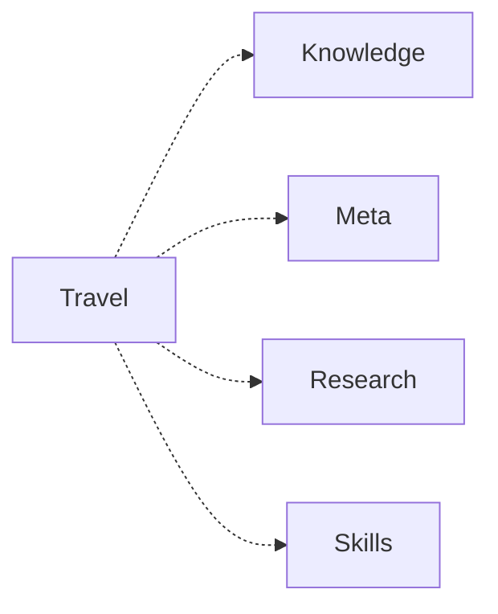

# Travel

[简体中文](README.md)

Research, plan and render an owned trip as an offline website.

This repository is the independent publication authority for Travel. Start with the [domain guide](README.md) and the [module contract](module.json). Follow the listed runtime prerequisites. User projects, facts, accounts and runtime stay in user-owned locations. AWS and meta are optional collaboration and governance integrations.

```text
python .module/module_manager.py verify
python .module/module_manager.py related
python .module/module_manager.py audit --target <workspace> --modules <related-id>
python .module/module_manager.py fetch --target <workspace> --modules <related-id> --apply
```

Review existing workflows, ownership and interfaces before retrieval. The manager reuses a matching verified module and preserves existing directories and edits. Fetching a peer does not run its services or complete a business integration. See [cooperation](docs/module-cooperation.md) for handoff and recovery.

<!-- module-panorama:start -->


虚线表示可选协作。具体用途与接口见 module.json 和协作说明。 / Dashed edges indicate optional cooperation. See module.json and the cooperation guide.
<!-- module-panorama:end -->

The [AWS overview](https://github.com/ZhongTyler/AgentWorkSpace) presents the full module network. This module retains original third-party notices and the reviewed 1.30.0 source record. Independent module versioning starts at 2.0.0.
